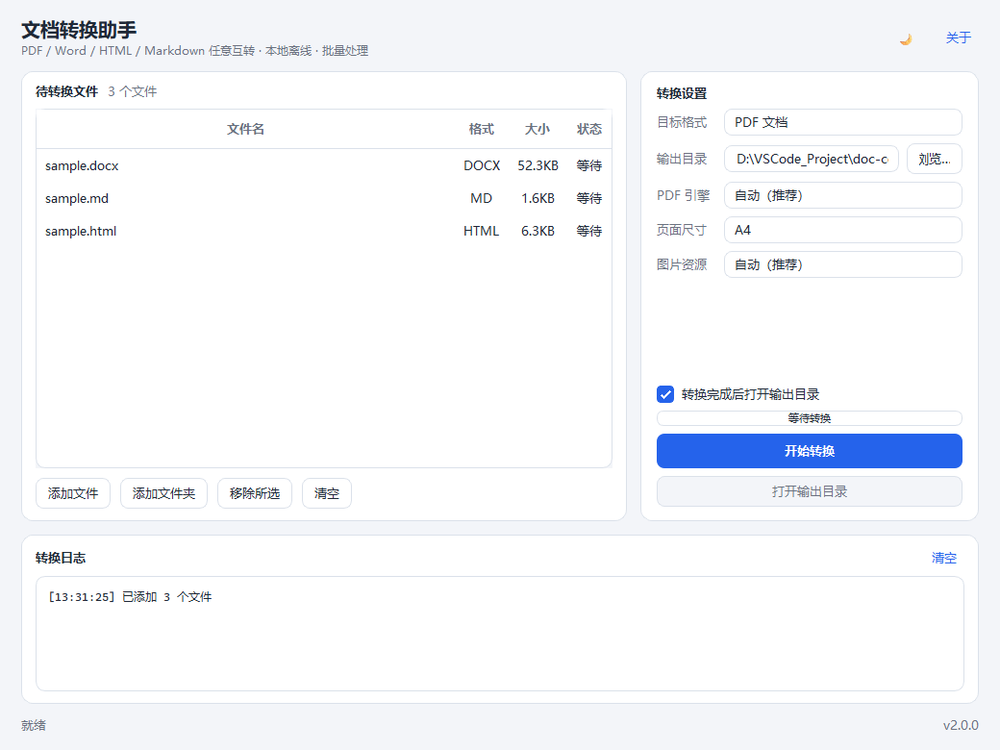
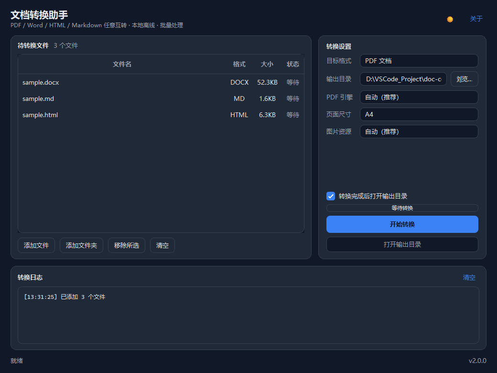

# doc-converter · 文档转换助手

<div align="center">

**PDF / DOCX / HTML / Markdown 任意互转 · 桌面版 + 命令行 + Python API**

[](https://www.python.org/)
[](https://doc.qt.io/qtforpython/)
[]()
[](LICENSE)
[]()

**语言 / Language**：[English](README_EN.md) | [简体中文](README.md)

</div>

---

## 简介

`doc-converter` 是一个完全离线的文档格式转换工具，支持 **PDF、DOCX、HTML、Markdown 四种格式之间的任意互转**（共 12 种有效组合），并提供三种使用方式：

- **Windows 桌面程序**：`DocConverter.exe`，双击即用，支持拖拽与批量转换；
- **命令行**：`doc-converter.exe`（或 `python -m doc_converter`），适合脚本与批处理；
- **Python API**：`convert()` / `convert_batch()`，方便集成到其他系统。

转换并非简单的文本搬运，而是采用 **统一中间表示（IR）** 架构：

```
源文档 ──► Reader ──► Document(IR) ──► Writer ──► 目标文档
          (docx/html/md/pdf)          (md/html/docx/pdf)
```

IR 完整描述标题层级、段落、列表（含嵌套）、表格（含合并单元格）、超链接、行内/块级图片、代码块、引用、流程图结构、二进制附件与文档元数据。新增一种格式只需实现一对 Reader/Writer，即可自动获得与其他所有格式的互转能力。



## 功能特性

| 能力 | 说明 |
| --- | --- |
| 任意互转 | 4 种格式两两互转，共 12 种组合 |
| 结构保留 | 标题层级、段落、有序/无序/嵌套列表、表格（表头 / colspan / rowspan）、引用、代码块、水平线 |
| 基础样式 | 加粗、斜体、下划线、删除线、行内代码、上下标、文字颜色 |
| 列表还原 | Markdown / HTML 嵌套列表保留父子关系；DOCX 读取 `w:numPr` 编号定义（含本地化样式名），有序列表在 Word 中逐列表重新编号 |
| 图片 | DOCX 图片二进制提取 / PDF 图片优先提取原始流、失败时裁剪导出 / HTML·MD 相对路径、data URI、远程 URL；输出为独立文件、内联 data URI 或 DOCX 原生嵌入，并写入替代文字 |
| 流程图 | DOCX 组合形状提取节点；Markdown Mermaid 解析为流程结构并保留源码；按目标格式能力渲染（MD→Mermaid、HTML→Mermaid、DOCX→节点框+源码附录、PDF→文本结构） |
| 附件 | DOCX OLE 对象、PDF EmbeddedFile 自动提取并落盘；输出 PDF 时**额外嵌入 PDF 附件本身**，可再次提取 |
| 元数据 | DOCX/PDF 标题、作者、主题、关键词读写；HTML `<meta>` 与 `<title>`；PDF 输出写入 `/Title`、`/Author` 等属性 |
| PDF 引擎 | 自动选择：本机 Edge/Chrome 无头打印 → WeasyPrint → xhtml2pdf，失败自动降级并给出告警 |
| 批量处理 | 多文件 / glob / 目录递归；同名输出自动改名；单个文件失败不影响其余文件 |
| 降级与诊断 | 所有无法完美转换的元素均给出明确告警（`ConversionResult.warnings`），不静默丢失内容 |
| 桌面体验 | 拖拽、批量进度、逐文件状态、实时日志、深浅色主题、取消、打开输出目录、设置记忆 |

### 桌面版截图

| 浅色主题 | 深色主题 |
| --- | --- |
|  |  |

## 下载与运行（Windows）

直接运行发布目录中的 `dist\DocConverter.exe`（单文件，无需安装 Python）：

1. 双击 `DocConverter.exe` 打开桌面版；
2. 把文件或文件夹拖入窗口，或点击「添加文件 / 添加文件夹」；
3. 选择目标格式（PDF / Word / 网页 / Markdown）、输出目录与 PDF 选项；
4. 点击「开始转换」，在下方日志查看结果与提示。

> **PDF 排版建议**：Windows 10/11 自带 Microsoft Edge，程序会调用其无头打印引擎，中文、表格、代码块的排版效果最佳。若系统精简掉了 Edge，会自动降级到内置的 xhtml2pdf 引擎。

也可以从命令行调用同一个程序：

```bat
DocConverter.exe --help
DocConverter.exe report.docx -t md -o out\
DocConverter.exe "docs\*.pdf" -t docx -o out\ --pdf-engine chromium
DocConverter.exe docs\ -t html -o out\ --page-size A4
```

## 命令行

安装后可使用 `doc-converter`，或直接运行打包的 `doc-converter.exe`：

```bash
# 单文件
doc-converter report.docx -t md -o out/

# 批量（glob / 目录递归）
doc-converter "docs/*.docx" -t pdf -o out/
doc-converter docs/ -t html -o out/

# 指定 PDF 引擎与页面尺寸
doc-converter report.md -t pdf --pdf-engine chromium --page-size A4

# 显式指定源格式与资源模式
doc-converter input.bin -f html -t docx -o out/ --assets embed
```

完整参数：

```
usage: doc-converter [-h] -t {pdf,docx,html,md} [-f {pdf,docx,html,md}]
                     [-o PATH] [--assets {file,datauri,embed}]
                     [--pdf-engine {auto,chromium,weasyprint,xhtml2pdf}]
                     [--page-size {A4,Letter,A3,A5}] [-q] [--strict]
                     [--list-engines] [-V]
                     [INPUT ...]
```

| 参数 | 说明 |
| --- | --- |
| `INPUT` | 输入文件 / glob / 目录（目录递归收集受支持的文件），可传多个 |
| `-t, --to` | 目标格式：`pdf` / `docx` / `html` / `md` |
| `-f, --from` | 源格式（缺省按扩展名推断；支持 `doc`→`docx`、`htm`→`html`、`markdown`→`md` 等别名） |
| `-o, --output` | 输出路径：目录（自动命名 `原文件名.目标格式`）或具体文件 |
| `--assets` | 资源落地方式：`file`（MD/HTML 默认）、`datauri`（PDF 默认）、`embed`（DOCX 默认） |
| `--pdf-engine` | PDF 排版引擎，默认 `auto`；`--list-engines` 可查看当前可用引擎 |
| `--page-size` | PDF 页面尺寸，默认 `A4` |
| `-q, --quiet` | 仅输出错误 |
| `--strict` | 批量模式下遇到首个失败即中止 |
| `-V, --version` | 显示版本号 |

提示：`DocConverter.exe`（GUI 版）同样接受上述参数；从终端调用时会自动附加到当前控制台输出。

## Python API

```python
from doc_converter import convert, convert_batch

# 单文件
result = convert("report.docx", target="md", output="out/")
print(result.output)          # out/report.md
print(result.warnings)        # 降级/诊断信息
print(result.assets)          # 生成的资源文件列表

# PDF 选项
result = convert("report.md", target="pdf", output="out/",
                 pdf_engine="chromium", page_size="A4")
print(result.engine)          # 实际使用的引擎

# 批量（单文件失败不中断）
results, failures = convert_batch(
    ["a.docx", "b.html", "c.pdf"], target="md", output="out/")
```

## 转换矩阵与能力边界

| 源 \ 目标 | Markdown | HTML | DOCX | PDF |
| --- | :-: | :-: | :-: | :-: |
| **Markdown** | — | ✅ | ✅ | ✅ |
| **HTML** | ✅ | — | ✅ | ✅ |
| **DOCX** | ✅ | ✅ | — | ✅ |
| **PDF** | ⚠️ | ⚠️ | ⚠️ | — |

图例：✅ 完整支持；⚠️ 启发式重建（PDF 为版式驱动格式，标题层级依据字号推断、表格依据框线/列对齐重建、链接依据注释提取，均有告警提示）。

### 典型降级策略

| 场景 | 处理方式 |
| --- | --- |
| PDF 无语义结构 | 字号聚类 + 粗体比例推断标题；行距/缩进聚合段落；输出告警 |
| PDF 无框线表格 | 先尝试框线，再用"列对齐"启发式重建；过滤整页误判 |
| PDF 页眉页脚 | 多页重复的边缘文字自动剔除；页码行剔除 |
| DOCX 流程图 | 提取各形状文本为节点；连接关系无法可靠恢复时按顺序连边并告警 |
| DOCX 单个文本框 | 识别为普通段落（不误判为流程图） |
| DOCX 内容控件 / 修订 | 展开 `w:sdt` 与 `w:ins`，跳过 `w:del` 删除内容 |
| Markdown 无下划线语法 | 下划线降级为 `<u>` 标签（HTML 兼容） |
| DOCX 渲染 Mermaid | 转为"节点框 + 箭头"与文末 Mermaid 源码附录（可粘贴到 mermaid.live 精修） |
| 远程图片 | DOCX/PDF 输出会尝试下载并内嵌（10 秒超时、32MB 上限）；MD/HTML 默认保留原 URL |
| SVG / EMF 图片 | DOCX 无法直接嵌入时输出占位说明并告警，不静默丢弃 |
| 无法解析的图片/附件 | 输出占位说明并告警 |

### 已知限制

- PDF 是版式格式，复杂分栏、公式、扫描件（图片型 PDF）无法还原为结构化文本；扫描件会得到图片而非文字。
- DOCX 的 SmartArt、图表、Equation 公式、批注、页眉页脚不在 IR 范围内，会被跳过或降级；流程图连接关系只能按顺序降级。
- Markdown 不支持单元格合并，`colspan/rowspan` 会在 Markdown 输出中展开为空单元格。
- 加密/受密码保护的 PDF、DOCX 需要先解除保护。

## PDF 输出引擎

程序按以下顺序自动选择，任一环节失败会降级并记录告警：

1. **Chromium / Microsoft Edge**（默认，Windows 10/11 自带）：`--headless=new --print-to-pdf`，CSS、表格、中文、代码块效果最佳，零额外依赖；
2. **WeasyPrint**：需 GTK/Pango 原生运行时（Linux/macOS 常见，Windows 一般不可用）；
3. **xhtml2pdf**：纯 Python 兜底，自动嵌入系统中文字体（微软雅黑/等线/黑体/宋体），保证中文不出现方框。

可用引擎：

```bash
doc-converter --list-engines
```

## 安装（开发 / 源码运行）

```bash
# 方式一：作为库/命令行工具安装
pip install -e ".[gui]"

# 方式二：安装依赖后直接使用
pip install -r requirements.txt
pip install PySide6            # 需要桌面版时
python -m doc_converter        # 命令行
python -m doc_converter.gui    # 桌面版
```

要求 Python **3.10+**（已在 3.14 上完整验证）。

## 测试

```bash
pip install pytest
pytest -q          # 84 passed
```

覆盖范围：

- **12 种互转矩阵**：每个组合的产物存在性、结构断言、内容断言；
- **读取器**：DOCX 本地化样式 / `w:numPr` / 内容控件 / 修订 / 文本框 / 合并表格 / 超链接 / 图片 / OLE 附件；HTML 嵌套列表 / colspan / 元数据 / 裸文本 / 定义列表 / 代码块；Markdown 嵌套列表 / Mermaid / front matter / 内联 HTML；PDF 标题 / 段落 / 列表 / 表格 / 页眉页脚剔除；
- **写入器**：Markdown 转义与嵌套、HTML 语义结构与打印样式、DOCX 编号重启 / 合并单元格 / 图片替代文字 / 超链接关系、PDF 引擎选择 / 页面尺寸 / 附件嵌入；
- **命令行**：版本、引擎列表、单文件、批量冲突、glob、目录递归、strict；
- **桌面 GUI**（offscreen）：窗口构建、文件增删、目录过滤、PDF 选项联动、主题切换、完整转换流程、失败状态。

## 打包 Windows 可执行程序

```bash
python -m pip install pyinstaller PySide6
python packaging/build.py            # 同时构建 GUI 与 CLI
# 或
python packaging/build.py --gui
python packaging/build.py --cli
```

产物：

| 文件 | 说明 |
| --- | --- |
| `dist/DocConverter.exe` | 桌面版（单文件、无控制台、含 CLI 参数支持） |
| `dist/doc-converter.exe` | 命令行版（单文件、体积更小） |

打包配置位于 `packaging/DocConverter.spec`、`packaging/doc-converter-cli.spec`，图标与版本资源由 `packaging/build.py` 自动生成。

## 项目结构

```
doc-converter/
├── src/doc_converter/
│   ├── __init__.py            # 公共 API 导出
│   ├── __main__.py            # python -m doc_converter（CLI）
│   ├── cli.py                 # 命令行（argparse）
│   ├── launcher.py            # 统一入口：GUI / CLI 自动分流
│   ├── converter.py           # 转换编排：读 -> IR -> 写
│   ├── model.py               # 统一中间表示（Document/Block/Inline）
│   ├── assets.py              # 图片/附件资源管理（file/datauri/embed + 远程下载）
│   ├── pdf_engine.py          # PDF 引擎探测与调度（Chromium/WeasyPrint/xhtml2pdf）
│   ├── errors.py              # 异常与错误码体系
│   ├── utils.py               # 通用工具
│   ├── readers/               # 四种源格式读取器
│   │   ├── docx_reader.py     #   python-docx + 原始 XML（编号/控件/修订/形状）
│   │   ├── html_reader.py     #   BeautifulSoup 递归解析
│   │   ├── markdown_reader.py #   markdown-it-py（GFM + Mermaid + front matter）
│   │   └── pdf_reader.py      #   pdfplumber 启发式重建 + pypdf 附件
│   ├── writers/               # 四种目标格式写入器
│   │   ├── markdown_writer.py #   GFM（嵌套列表/管道表格/Mermaid/转义）
│   │   ├── html_writer.py     #   语义化 HTML + 内置样式 + 打印样式
│   │   ├── docx_writer.py     #   python-docx（编号/合并/嵌入图片/超链接）
│   │   └── pdf_writer.py      #   多引擎 PDF + 元数据/附件后处理
│   └── gui/                   # PySide6 桌面版
│       ├── app.py             #   主窗口、转换线程、拖拽
│       └── theme.py           #   深浅色主题
├── packaging/                 # PyInstaller 配置、图标、构建脚本
├── examples/
│   ├── make_samples.py        # 生成四种格式示例
│   └── convert_all.py         # 12 种互转端到端验证
├── tests/                     # 84 个自动化测试
├── docs/                      # 截图
├── samples/                   # 四种格式示例文档
├── pyproject.toml
├── requirements.txt
└── LICENSE
```

## 设计说明

- **为什么用 IR 而不是两两转换？** 两两直连需要 12 套逻辑；IR 架构只需 4+4 个读写器，且天然保证任意路径的一致性。
- **资源为什么分三种模式？** Markdown/HTML 需要文件引用（便于版本管理与阅读）；PDF 必须自包含（data URI）；DOCX 原生支持二进制嵌入（embed）。
- **PDF 为什么是"重建"？** PDF 只记录绘制指令，不保留语义结构。本项目通过字号聚类、文本行聚合、表格策略（lines → 列对齐）尽力重建，并通过 warnings 明确告知差异，而不是假装完美。
- **为什么优先调用 Edge？** Windows 自带、无需安装、CSS 支持完整，比纯 Python 引擎的排版质量高一个量级；同时保留 WeasyPrint / xhtml2pdf 作为跨平台降级方案。

## 依赖

| 包 | 版本 | 用途 |
| --- | --- | --- |
| `python-docx` | 1.2+ | DOCX 读写 |
| `beautifulsoup4` + `lxml` | 4.14+ / 6.0+ | HTML 解析 |
| `markdown-it-py` + `linkify-it-py` | 4.0+ / 2.0+ | Markdown 解析（GFM） |
| `pdfplumber` | 0.11.8+ | PDF 文本/表格/图片提取 |
| `pypdf` | 6.0+ | PDF 元数据、附件、后处理 |
| `Pillow` | 11.0+ | 图片处理 |
| `xhtml2pdf` | 0.2.17+ | PDF 兜底引擎 |
| `PySide6`（可选） | 6.9+ | 桌面 GUI |
| `weasyprint`（可选） | 65+ | PDF 首选引擎（需 GTK） |
| `pyinstaller`（开发） | 6.16+ | Windows 打包 |

## License

[MIT](LICENSE)
