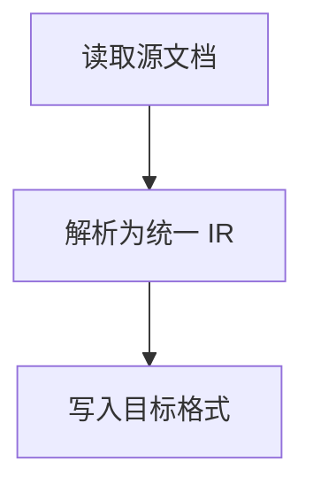

# doc-converter

<div align="center">

**PDF / DOCX / HTML / Markdown 任意互转的文档转换助手**

[](https://www.python.org/)
[](LICENSE)
[]()
[]()

**语言 / Language**：[English](README_EN.md) | [简体中文](README.md)

</div>

---

## 简介

`doc-converter` 是一个纯 Python 的文档格式转换工具，支持 **PDF、DOCX、HTML、Markdown 四种格式之间的任意互转**（共 12 种有效组合）。

转换并非简单的文本搬运，而是采用 **统一中间表示（IR）** 架构：

```
源文档 ──► Reader ──► Document(IR) ──► Writer ──► 目标文档
          (docx/html/md/pdf)          (md/html/docx/pdf)
```

IR 完整描述标题层级、段落、列表（含嵌套）、表格、超链接、行内/块级图片、代码块、引用、流程图结构、二进制附件等元素。新增一种格式只需实现一对 Reader/Writer，即可自动获得与其他所有格式的互转能力。

## 功能特性

| 能力 | 说明 |
| --- | --- |
| 任意互转 | 4 种格式两两互转，共 12 种组合，文本内容完整保留 |
| 结构保留 | 标题层级、段落、有序/无序/嵌套列表、表格（含表头）、引用、代码块、水平线 |
| 基础样式 | 加粗、斜体、下划线、删除线、行内代码、文字颜色（按目标格式能力映射） |
| 图片 | DOCX 图片二进制提取 / PDF 图片按区域裁剪导出 / HTML·MD 相对路径与 data URI 解析；输出为独立文件并正确引用（DOCX 内嵌、PDF 内联） |
| 流程图 | DOCX 组合形状（SmartArt/文本框+连接线）提取节点；Markdown Mermaid 代码块解析为流程结构；按目标格式能力渲染（MD→Mermaid、HTML→Mermaid 渲染、DOCX→节点列表+Mermaid 附录、PDF→文本结构） |
| 附件 | DOCX OLE 嵌入对象、PDF EmbeddedFile 自动提取并落盘，在输出中以链接关联 |
| 批量转换 | 支持多文件、glob 通配、目录输出；单文件失败不影响其余文件 |
| 降级与诊断 | 所有无法完美转换的元素均给出明确告警（`ConversionResult.warnings`），不静默丢失内容 |
| 接口完备 | Python API（`convert` / `convert_batch`）+ 命令行（`python -m doc_converter`） |

## 安装

```bash
# 方式一：作为库/命令行工具安装
pip install -e .

# 方式二：仅安装依赖后在 src/ 目录下使用
pip install -r requirements.txt
```

> **关于 PDF 输出引擎**：优先使用 [WeasyPrint](https://weasyprint.org/)（排版质量最佳，需 GTK/Pango 原生运行时，Linux/macOS 通常开箱即用）；未安装或原生库不可用时自动降级到纯 Python 的 `xhtml2pdf`（已内置中日韩字体注册，中文不会变成方框）。

## 快速开始

### 命令行

```bash
# 单文件转换（源格式按扩展名自动识别）
python -m doc_converter report.docx -t md -o out/

# 批量转换（支持 glob，Shell 不展开时由程序展开）
python -m doc_converter "docs/*.docx" -t pdf -o out/

# 显式指定源格式与资源落地方式
python -m doc_converter input.bin -f html -t docx -o out/ --assets embed
```

完整参数：

```
usage: doc-converter [-h] -t {pdf,docx,html,md} [-f {pdf,docx,html,md}]
                     [-o PATH] [--assets {file,datauri,embed}] [-q] [--strict]
                     INPUT [INPUT ...]
```

| 参数 | 说明 |
| --- | --- |
| `INPUT` | 输入文件，支持 glob 模式，可一次传多个 |
| `-t, --to` | 目标格式：`pdf` / `docx` / `html` / `md` |
| `-f, --from` | 源格式（缺省按扩展名推断；也支持 `doc`→`docx`、`htm`→`html`、`markdown`→`md` 等别名） |
| `-o, --output` | 输出路径：目录（自动命名 `原文件名.目标格式`）或具体文件（仅单文件时建议） |
| `--assets` | 资源落地方式：`file`（默认，MD/HTML）、`datauri`（PDF 默认）、`embed`（DOCX 默认，二进制嵌入） |
| `-q, --quiet` | 仅输出错误 |
| `--strict` | 批量模式下遇到首个失败即中止 |

### Python API

```python
from doc_converter import convert, convert_batch

# 单文件
result = convert("report.docx", target="md", output="out/")
print(result.output)          # out/report.md
print(result.warnings)        # 降级/诊断信息
print(result.assets)          # 生成的资源文件列表

# 批量（单文件失败不中断）
results, failures = convert_batch(
    ["a.docx", "b.html", "c.pdf"], target="md", output="out/")
```

## 转换矩阵与能力边界

| 源 \ 目标 | Markdown | HTML | DOCX | PDF |
| --- | :-: | :-: | :-: | :-: |
| **Markdown** | — | ✅ | ✅ | ✅ |
| **HTML** | ✅ | — | ✅ | ✅ |
| **DOCX** | ✅ | ✅ | — | ✅ |
| **PDF** | ⚠️ | ⚠️ | ⚠️ | — |

图例：✅ 完整支持；⚠️ 启发式重建（PDF 为版式驱动格式，标题层级依据字号推断、表格依据文本位置/框线重建、链接依据注释提取，均有告警提示）。

### 典型降级策略

| 场景 | 处理方式 |
| --- | --- |
| PDF 无语义结构 | 字号聚类推断标题、行聚合推断段落，输出告警 |
| PDF 无框线表格 | 回退到"文本对齐"策略重建，输出告警 |
| DOCX 流程图 | 提取各形状文本为节点；连接关系无法可靠恢复时按顺序连边并告警 |
| Markdown 无下划线语法 | 下划线降级为 `<u>` 标签（HTML 兼容） |
| DOCX 渲染 Mermaid | 转为"节点列表 + 文末 Mermaid 源码附录"（可粘贴到 mermaid.live 精修） |
| 远程图片（http(s)） | 保留原 URL 引用，不下载（避免网络依赖） |
| 无法解析的图片/附件 | 输出占位说明并告警，不静默丢弃 |

## 示例：带图片和流程图的 DOCX → Markdown

输入 `sample.docx`（含标题、列表、表格、超链接、图片、组合形状流程图、嵌入 CSV 附件），执行：

```bash
python -m doc_converter samples/sample.docx -t md -o out/
```

输出 `out/sample.md` 关键片段：

````markdown
## 流程图



## 图片


📎 [sample-data.csv](sample_assets/ec0505-sample-data.csv)
````

- 图片保存为 `sample_assets/` 下的独立文件并被正确引用；
- 流程图转换为 GitHub 可直接渲染的 Mermaid 代码块；
- 嵌入附件提取为文件并以链接关联。

一键复现（生成全部四种示例并执行 12 种互转）：

```bash
python examples/make_samples.py     # 生成 samples/ 下四种格式示例
python examples/convert_all.py      # 执行 12 种互换并打印告警，产物在 out/
```

## 项目结构

```
doc-converter/
├── src/doc_converter/
│   ├── __init__.py            # 公共 API 导出
│   ├── __main__.py            # python -m doc_converter 入口
│   ├── cli.py                 # 命令行（argparse）
│   ├── converter.py           # 转换编排：读 -> IR -> 写
│   ├── model.py               # 统一中间表示（Document/Block/Inline）
│   ├── assets.py              # 图片/附件资源管理（file/datauri/embed）
│   ├── errors.py              # 异常与错误码体系
│   ├── utils.py               # 通用工具
│   ├── readers/               # 四种源格式读取器
│   │   ├── docx_reader.py     #   python-docx，含组合形状/OLE 附件
│   │   ├── html_reader.py     #   BeautifulSoup 递归解析
│   │   ├── markdown_reader.py #   markdown-it-py（GFM + Mermaid）
│   │   └── pdf_reader.py      #   pdfplumber 启发式重建 + pypdf 附件
│   └── writers/               # 四种目标格式写入器
│       ├── markdown_writer.py #   GFM（管道表格/Mermaid/转义）
│       ├── html_writer.py     #   语义化 HTML + 内置样式
│       ├── docx_writer.py     #   python-docx（样式/表格/超链接/嵌入图片）
│       └── pdf_writer.py      #   WeasyPrint / xhtml2pdf 双引擎
├── examples/
│   ├── make_samples.py        # 生成四种格式的示例文档
│   └── convert_all.py         # 12 种互转组合端到端验证
├── tests/
│   ├── conftest.py
│   └── test_converter.py      # 19 个用例：矩阵/结构/资源/CLI/错误处理
├── pyproject.toml             # 打包与依赖（含 doc-converter 命令入口）
├── requirements.txt
├── LICENSE                    # MIT
├── README.md                  # 简体中文（当前）
└── README_EN.md               # English
```

## 测试

```bash
pip install pytest
pytest -q          # 19 passed
```

覆盖：四种源格式互转、标题/列表/表格/链接/代码块结构断言、图片落盘与 DOCX 内嵌、附件提取、批量容错、CLI 行为、错误码（文件不存在/不支持格式/同格式转换）。

## 扩展新格式

```python
from doc_converter.readers.base import BaseReader, register_reader
from doc_converter.writers.base import BaseWriter, register_writer
from doc_converter.model import Document

@register_reader
class RstReader(BaseReader):
    extensions = ("rst",)
    def read(self, path, doc: Document) -> Document:
        ...  # 解析为 doc.blocks

@register_writer
class RstWriter(BaseWriter):
    extension = "rst"
    def write(self, doc: Document, out_path, assets) -> Path:
        ...  # 渲染 doc.blocks
```

注册后立即可用：`convert("a.rst", target="md")`。

## 设计说明

- **为什么用 IR 而不是两两转换？** 两两直连需要 12 套逻辑；IR 架构只需 4+4 个读写器，且天然保证任意路径的一致性。
- **资源为什么分三种模式？** Markdown/HTML 需要文件引用（便于版本管理与阅读）；PDF 必须自包含（data URI）；DOCX 原生支持二进制嵌入（embed）。
- **PDF 为什么是"重建"？** PDF 只记录绘制指令，不保留语义结构。本项目通过字号聚类、文本行聚合、表格策略（lines → text 回退）尽力重建，并通过 warnings 明确告知差异，而不是假装完美。

## 依赖

| 包 | 用途 |
| --- | --- |
| `python-docx` | DOCX 读写 |
| `beautifulsoup4` | HTML 解析 |
| `markdown-it-py` + `linkify-it-py` | Markdown 解析（GFM 兼容） |
| `pdfplumber` | PDF 文本/表格/图片提取 |
| `pypdf` | PDF 嵌入附件提取 |
| `Pillow` | 图片处理 |
| `xhtml2pdf` | PDF 输出引擎（纯 Python 降级方案） |
| `weasyprint`（可选） | PDF 输出引擎（首选，需 GTK 运行时） |

## License

[MIT](LICENSE)
