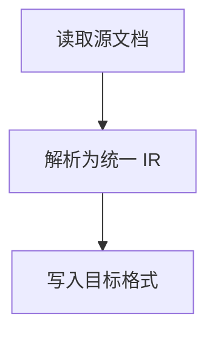

# doc-converter

<div align="center">

**A document conversion toolkit for lossless conversion between PDF, DOCX, HTML, and Markdown**

[](https://www.python.org/)
[](LICENSE)
[]()
[]()

**Language**: English · [简体中文](README.md)

</div>

---

## Introduction

`doc-converter` is a pure-Python document format conversion tool that supports **arbitrary conversion between PDF, DOCX, HTML, and Markdown** (12 valid combinations in total).

Rather than naive text copying, conversion is built on a **unified intermediate representation (IR)** architecture:

```
Source ──► Reader ──► Document (IR) ──► Writer ──► Target
          (docx/html/md/pdf)            (md/html/docx/pdf)
```

The IR fully describes heading levels, paragraphs, lists (including nesting), tables, hyperlinks, inline/block images, code blocks, quotations, flowchart structures, binary attachments, and more. Adding support for a new format only requires implementing one Reader/Writer pair, which automatically gains interoperability with every other format.

## Features

| Capability | Description |
| --- | --- |
| Universal conversion | Pairwise conversion across 4 formats, 12 combinations, with complete text preservation |
| Structure preservation | Heading levels, paragraphs, ordered/unordered/nested lists, tables (with headers), block quotes, code blocks, horizontal rules |
| Basic styling | Bold, italic, underline, strikethrough, inline code, and text color (mapped according to target format capabilities) |
| Images | Binary extraction for DOCX, region-based cropping for PDF, relative-path and data URI resolution for HTML/Markdown; output as standalone files with correct references (embedded in DOCX, inlined in PDF) |
| Flowcharts | Node extraction from DOCX group shapes (SmartArt/text boxes with connectors); Mermaid code blocks parsed into flowchart structures; rendered according to target format capabilities (MD→Mermaid, HTML→rendered Mermaid, DOCX→node list + Mermaid appendix, PDF→text structure) |
| Attachments | Automatic extraction of DOCX OLE embedded objects and PDF EmbeddedFiles to disk, linked in the output |
| Batch conversion | Multiple files, glob patterns, directory output; failure of a single file does not affect the others |
| Graceful degradation | Every element that cannot be perfectly converted produces an explicit warning (`ConversionResult.warnings`) instead of being silently dropped |
| Complete interfaces | Python API (`convert` / `convert_batch`) plus a command-line entry point (`python -m doc_converter`) |

## Installation

```bash
# Option 1: install as a library / CLI tool
pip install -e .

# Option 2: install dependencies only and run from the src/ directory
pip install -r requirements.txt
```

> **About the PDF output engine**: [WeasyPrint](https://weasyprint.org/) is preferred (best typographic quality, but requires the GTK/Pango native runtime; usually works out of the box on Linux/macOS). When it is not installed or the native libraries are unavailable, the tool automatically falls back to the pure-Python `xhtml2pdf` (with built-in CJK font registration, so Chinese text does not turn into boxes).

## Quick Start

### Command Line

```bash
# Single file (source format is inferred from the file extension)
python -m doc_converter report.docx -t md -o out/

# Batch conversion (glob supported; expanded by the program when the shell does not)
python -m doc_converter "docs/*.docx" -t pdf -o out/

# Explicitly specify the source format and asset handling
python -m doc_converter input.bin -f html -t docx -o out/ --assets embed
```

Full arguments:

```
usage: doc-converter [-h] -t {pdf,docx,html,md} [-f {pdf,docx,html,md}]
                     [-o PATH] [--assets {file,datauri,embed}] [-q] [--strict]
                     INPUT [INPUT ...]
```

| Argument | Description |
| --- | --- |
| `INPUT` | Input file(s); glob patterns are supported and multiple files can be passed at once |
| `-t, --to` | Target format: `pdf` / `docx` / `html` / `md` |
| `-f, --from` | Source format (inferred from the extension by default; aliases such as `doc`→`docx`, `htm`→`html`, `markdown`→`md` are also supported) |
| `-o, --output` | Output path: a directory (auto-named `original-name.target-format`) or a specific file (recommended for single-file conversion only) |
| `--assets` | Asset handling mode: `file` (default, for MD/HTML), `datauri` (default for PDF), `embed` (default for DOCX, binary embedding) |
| `-q, --quiet` | Print errors only |
| `--strict` | Abort on the first failure in batch mode |

### Python API

```python
from doc_converter import convert, convert_batch

# Single file
result = convert("report.docx", target="md", output="out/")
print(result.output)          # out/report.md
print(result.warnings)        # degradation / diagnostic messages
print(result.assets)          # generated asset files

# Batch (a single failure does not interrupt the rest)
results, failures = convert_batch(
    ["a.docx", "b.html", "c.pdf"], target="md", output="out/")
```

## Conversion Matrix and Capability Boundaries

| Source \ Target | Markdown | HTML | DOCX | PDF |
| --- | :-: | :-: | :-: | :-: |
| **Markdown** | — | ✅ | ✅ | ✅ |
| **HTML** | ✅ | — | ✅ | ✅ |
| **DOCX** | ✅ | ✅ | — | ✅ |
| **PDF** | ⚠️ | ⚠️ | ⚠️ | — |

Legend: ✅ fully supported; ⚠️ heuristic reconstruction (PDF is a layout-driven format: heading levels are inferred from font sizes, tables are rebuilt from text positions/rules, and links are extracted from annotations — each accompanied by a warning).

### Typical Degradation Strategies

| Scenario | Handling |
| --- | --- |
| PDF without semantic structure | Infer headings via font-size clustering and paragraphs via line aggregation, with a warning |
| PDF tables without borders | Fall back to the "text alignment" strategy for reconstruction, with a warning |
| DOCX flowcharts | Extract the text of each shape as nodes; when connector relationships cannot be reliably recovered, connect nodes in order and warn |
| Markdown has no underline syntax | Underline degrades to the `<u>` tag (HTML-compatible) |
| Rendering Mermaid in DOCX | Convert to "node list + Mermaid source appendix" (which can be pasted into mermaid.live for refinement) |
| Remote images (http(s)) | Keep the original URL reference; no download (avoids network dependencies) |
| Unparseable images/attachments | Emit a placeholder note and a warning instead of silently dropping |

## Example: DOCX with Images and a Flowchart → Markdown

Given an input `sample.docx` (containing headings, lists, a table, a hyperlink, an image, a group-shape flowchart, and an embedded CSV attachment), run:

```bash
python -m doc_converter samples/sample.docx -t md -o out/
```

Key excerpt of the output `out/sample.md`:

````markdown
## 流程图



## 图片


📎 [sample-data.csv](sample_assets/ec0505-sample-data.csv)
````

> Note: the node labels above reflect the original DOCX content (Chinese), which is
> preserved verbatim during conversion.

- The image is saved as a standalone file under `sample_assets/` and referenced correctly;
- The flowchart is converted into a Mermaid code block that GitHub can render directly;
- The embedded attachment is extracted as a file and linked.

One-command reproduction (generate all four samples and run all 12 conversions):

```bash
python examples/make_samples.py     # generate the four sample formats under samples/
python examples/convert_all.py      # run all 12 conversions and print warnings; output goes to out/
```

## Project Structure

```
doc-converter/
├── src/doc_converter/
│   ├── __init__.py            # public API exports
│   ├── __main__.py            # entry point for python -m doc_converter
│   ├── cli.py                 # command line (argparse)
│   ├── converter.py           # conversion orchestration: read -> IR -> write
│   ├── model.py               # unified intermediate representation (Document/Block/Inline)
│   ├── assets.py              # image/attachment asset management (file/datauri/embed)
│   ├── errors.py              # exception and error-code system
│   ├── utils.py               # general utilities
│   ├── readers/               # readers for the four source formats
│   │   ├── docx_reader.py     #   python-docx, with group shapes / OLE attachments
│   │   ├── html_reader.py     #   recursive parsing with BeautifulSoup
│   │   ├── markdown_reader.py #   markdown-it-py (GFM + Mermaid)
│   │   └── pdf_reader.py      #   heuristic reconstruction with pdfplumber + pypdf attachments
│   └── writers/               # writers for the four target formats
│       ├── markdown_writer.py #   GFM (pipe tables / Mermaid / escaping)
│       ├── html_writer.py     #   semantic HTML + built-in styles
│       ├── docx_writer.py     #   python-docx (styles/tables/hyperlinks/embedded images)
│       └── pdf_writer.py      #   dual engines: WeasyPrint / xhtml2pdf
├── examples/
│   ├── make_samples.py        # generate sample documents in all four formats
│   └── convert_all.py         # end-to-end verification of all 12 conversion combinations
├── tests/
│   ├── conftest.py
│   └── test_converter.py      # 19 test cases: matrix/structure/assets/CLI/error handling
├── pyproject.toml             # packaging and dependencies (including the doc-converter CLI entry point)
├── requirements.txt
├── LICENSE                    # MIT
├── README.md                  # 简体中文
└── README_EN.md               # English
```

## Testing

```bash
pip install pytest
pytest -q          # 19 passed
```

Coverage: pairwise conversion across the four source formats, structural assertions for headings/lists/tables/links/code blocks, image extraction and DOCX embedding, attachment extraction, batch fault tolerance, CLI behavior, and error codes (file not found / unsupported format / identical source and target formats).

## Adding a New Format

```python
from doc_converter.readers.base import BaseReader, register_reader
from doc_converter.writers.base import BaseWriter, register_writer
from doc_converter.model import Document

@register_reader
class RstReader(BaseReader):
    extensions = ("rst",)
    def read(self, path, doc: Document) -> Document:
        ...  # parse into doc.blocks

@register_writer
class RstWriter(BaseWriter):
    extension = "rst"
    def write(self, doc: Document, out_path, assets) -> Path:
        ...  # render doc.blocks
```

It becomes usable immediately after registration: `convert("a.rst", target="md")`.

## Design Notes

- **Why use an IR instead of pairwise conversion?** Direct pairwise conversion would require 12 sets of logic; the IR architecture needs only 4+4 readers/writers and inherently guarantees consistency across every conversion path.
- **Why three asset modes?** Markdown/HTML need file references (convenient for version control and reading); PDF must be self-contained (data URI); DOCX natively supports binary embedding (embed).
- **Why is PDF a "reconstruction"?** PDF only records drawing instructions and retains no semantic structure. This project reconstructs as much as possible via font-size clustering, text-line aggregation, and table strategies (lines → text fallback), and clearly communicates the differences through warnings rather than pretending to be perfect.

## Dependencies

| Package | Purpose |
| --- | --- |
| `python-docx` | DOCX reading and writing |
| `beautifulsoup4` | HTML parsing |
| `markdown-it-py` + `linkify-it-py` | Markdown parsing (GFM-compatible) |
| `pdfplumber` | PDF text/table/image extraction |
| `pypdf` | PDF embedded attachment extraction |
| `Pillow` | Image processing |
| `xhtml2pdf` | PDF output engine (pure-Python fallback) |
| `weasyprint` (optional) | PDF output engine (preferred, requires the GTK runtime) |

## License

[MIT](LICENSE)
