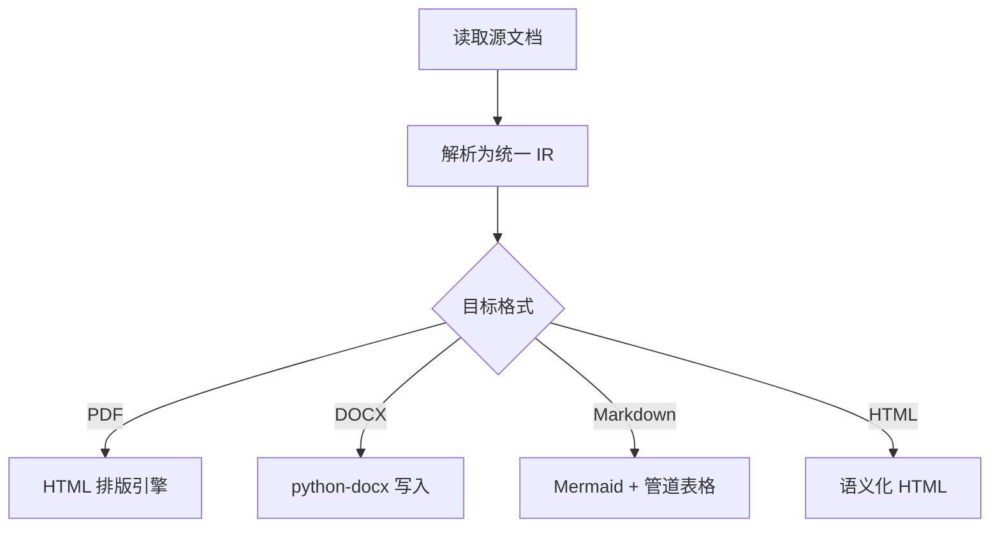
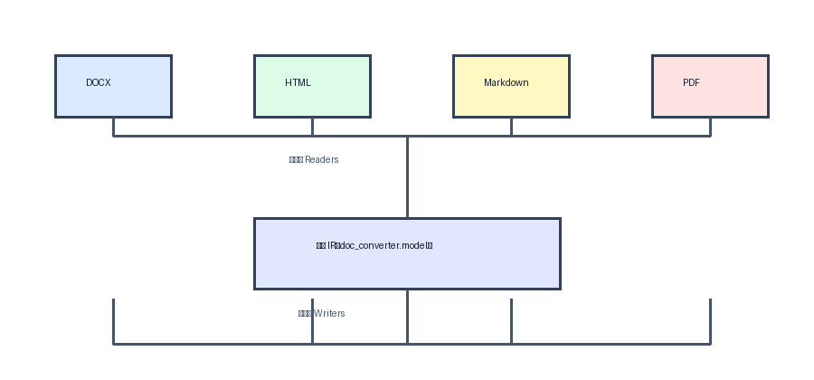

# 文档转换助手示例文档

本文档用于演示 **doc-converter** 对四种格式的处理能力，涵盖标题、列表、
表格、超链接、图片、流程图（Mermaid）与代码块。

## 功能特性

1. 支持 PDF、DOCX、HTML、Markdown 任意互转
2. 保留标题、段落、列表、表格等结构
3. 正确处理图片、流程图与嵌入附件
   - 图片保存为文件并在目标格式中引用
   - 流程结构转换为目标格式可表达的形式
4. 支持单文件与批量转换

## 结构对比表

| 格式 | 结构保留 | 图片 | 流程图 | 附件 |
| --- | --- | --- | --- | --- |
| PDF | 启发式重建 | 裁剪导出 | 转为文本结构 | EmbeddedFile |
| DOCX | 完整 | 嵌入 | 组合形状提取 | OLE 对象 |
| HTML | 完整 | 文件引用 | Mermaid 渲染 | 链接引用 |
| Markdown | 完整 | 文件引用 | Mermaid 代码块 | 链接引用 |

## 流程图示例



## 代码示例

```python
from doc_converter import convert

result = convert("sample.docx", target="md", output="out/")
print(result.output_path)
```

## 图片与链接



项目地址：<https://github.com/example/doc-converter>

## 引用与提示

> 提示：PDF 是版式驱动格式，标题层级由字号启发式推断。

***

*—— 由示例生成器创建 ——*
